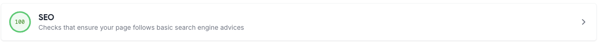
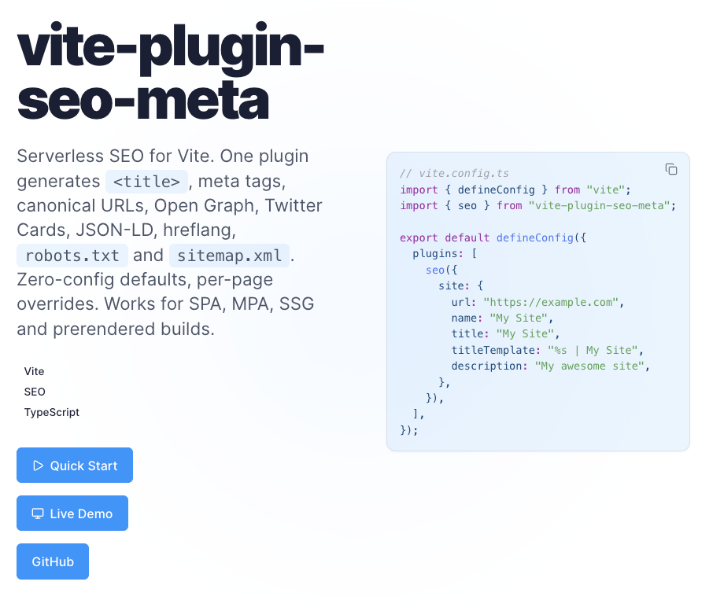
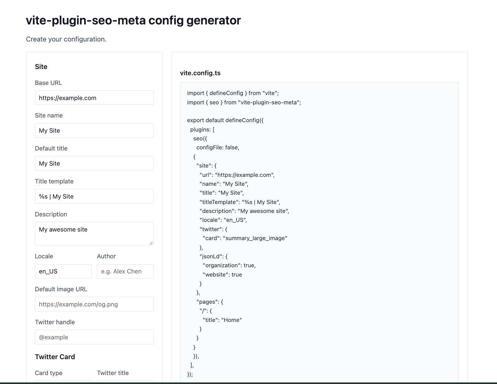

# vite-plugin-seo-meta

All-in-one Vite plugin that generates SEO metadata for your app: `<title>`, meta tags, canonical, Open Graph, Twitter Cards, JSON-LD (Organization/WebSite/Article/Product/BreadcrumbList/ImageObject), hreflang alternates, `robots.txt` and `sitemap.xml`. Zero-config defaults, per-page overrides. Works for SPA/MPA/SSG/prerendered builds.

[](https://www.npmjs.com/package/vite-plugin-seo-meta)
[](LICENSE)

[Documentation](https://nellowtcs.me/vite-plugin-seo-meta/) | [Live Demo](https://nellowtcs.me/vite-plugin-seo-meta/demo/)



## Installation

```bash
npm i -D vite-plugin-seo-meta vite
```

Vite 5 or newer. The plugin is ESM only.

## Quick start

```ts
import { defineConfig } from "vite";
import { seo } from "vite-plugin-seo-meta";

export default defineConfig({
  plugins: [
    seo({
      site: {
        url: "https://example.com",
        name: "My Site",
        title: "My Site",
        titleTemplate: "%s | My Site",
        description: "My awesome site",
      },
    }),
  ],
});
```

Per-page overrides go in `seo.config.ts`, which the plugin auto-loads:

```ts
import { defineSeoConfig } from "vite-plugin-seo-meta";

export default defineSeoConfig({
  site: { url: "https://example.com", name: "My Site" },
  pages: {
    "/about": { title: "About", description: "Who we are." }, // technically this would be flagged as too short, but oh well
    "/private": { title: "Secret", noindex: true },
  },
});
```

`defineSeoConfig` is a typed identity function. It does nothing at runtime as its only job is to make the config type-check haha.

## Features

- Zero-config: sensible defaults from `site` (sensible defaults that pass with flying colors (100%) on SEO audits)
- Per-page overrides via `pages`
- Canonical, Open Graph (full ogp.me spec incl. structured image/video/audio, type-specific verticals and `payment.link`)
- Twitter Cards (summary/summary_large_image/player/app, image dims/alt, label/data pairs, `:site:id`/`:creator:id`)
- JSON-LD: Organization, WebSite, Article, Product, BreadcrumbList, ImageObject (+ `extra` escape hatch)
- hreflang alternates per page (with self-referencing alternate)
- `robots.txt` following le spec at RFC 9309 (groups, `Allow`/`Disallow` with `*`/`$` wildcards, `Crawl-delay`, `Clean-param`, `Host`, `Sitemap`), merged with existing `public/robots.txt`
- `sitemap.xml` with image/video/news namespaces and `xhtml:link` alternates; single-host enforcement and a URL cap
- Rich favicon and platform icons: `apple-touch-icon`, `apple-touch-icon-precomposed`, `mask-icon`, `apple-mobile-web-app-*`, `msapplication-*`
- Coexistence detection: warns and defers to `vite-plugin-sitemap`/`vite-plugin-pwa` etc when present (override with `sitemap: true`/`robots: true`), to prevent double-builds and general pain.
- Pre-build validation: enums, required fields, absolute URLs, length budgets (title 60, description 50-160, Twitter 70/200); `warn` by default, `error` throws
- SPA runtime helper: `applySeo()` for client-side navigation (`import from "vite-plugin-seo-meta/runtime"`)
- Type-safe with `defineSeoConfig()` and full TypeScript types from the get go!

## Docs



Full configuration reference, guides for every feature, and API docs at [nellowtcs.me/vite-plugin-seo-meta](https://nellowtcs.me/vite-plugin-seo-meta/).

## Demo



A config generator demo lives in [`Demo/`](Demo/). It demonstrates the plugin and emits paste-ready configs. Build with `cd Demo && npm i && npx vite build`. Find it online at: [nellowtcs.me/vite-plugin-seo-meta/demo](https://nellowtcs.me/vite-plugin-seo-meta/demo)

## License

MIT
